# 后台管理

## 介绍
自己开发着玩的一个后台管理项目

## 技术栈

```
前端（back-stage-management-front）
- Vue.js 2.x
- Vue Router / Vuex
- Axios
- Node.js v18.12.1
- Webpack

后端（back_stage_management_django）
- Python 3.12
- Django 5.0.3
- Django REST Framework
- Redis
- MySQL
```

## 环境要求

| 组件    | 版本     |
| ------- | -------- |
| Node.js | v18.12.1 |
| Python  | 3.12     |
| Django  | 5.0.3    |


## JWT 与 HTTPS 开发环境说明

### 1. JWT 存储方式：HttpOnly Cookie

本项目采用 **HttpOnly Cookie** 存储 JWT，以提升安全性并防止 XSS 攻击。

#### 设计原则

- **access_token** 存储在 HttpOnly Cookie 中
  - 前端无法通过 JavaScript 读取
  - 浏览器会自动随请求发送
- 后端 Django 通过 `request.COOKIES['access_token']` 获取 token
- 前端 Axios 需开启跨域携带 Cookie：

```
axios.defaults.withCredentials = true
```

这种方式比 LocalStorage 更安全，适用于企业级前后端分离项目。

### 2. 为什么必须使用 HTTPS？

由于浏览器安全策略：

- **HttpOnly + Secure Cookie 只有在 HTTPS 下才能写入**
- 在 `http://localhost` 下 Cookie 会被浏览器直接拒绝
- 因此前端和后端的开发环境都必须支持 HTTPS

这也是本项目提供前后端 HTTPS 启动配置的原因。

### 3. 前端 HTTPS 启动（Vue CLI + Webpack）

前端通过 `vue.config.js` 配置自签证书，使开发环境以 HTTPS 方式运行：

```
devServer: {
  https: {
    key: fs.readFileSync('./certificate/localhost+3-key.pem'),
    cert: fs.readFileSync('./certificate/localhost+3.pem'),
  },
  host: '0.0.0.0',
  port: 8080,
  open: true,
}
```

#### 修改环境配置

修改.env.development

```
# ===========================
# 前端开发环境配置
# ===========================

# 后端 API 地址（开发环境）
# 你本地 Django 运行在哪就写哪
VUE_APP_BASE_URL=https://192.168.10.143:8000/

# 是否开启调试日志
VUE_APP_DEBUG=true

```

#### 启动方式

```
npm run serve
```

启动后访问：

```
https://192.168.10.143:8080/
```

这样前端才能正常写入 HttpOnly Cookie。

### 4. 后端 HTTPS 启动（Django 5.0.3）

项目提供了一个企业级 HTTPS 启动脚本 `manage_https.py`，用于在本地或局域网以 HTTPS 方式运行 Django 服务。

manage_https.py 配置自签证书，使开发环境以 HTTPS 方式运行：

以下代码配置证书路径为后端项目路径下certificate里

```
BASE_DIR = Path(__file__).resolve().parent
CERT_DIR = BASE_DIR / "certificate"
CERT_FILE = CERT_DIR / "localhost+3.pem"
KEY_FILE = CERT_DIR / "localhost+3-key.pem"
```

#### 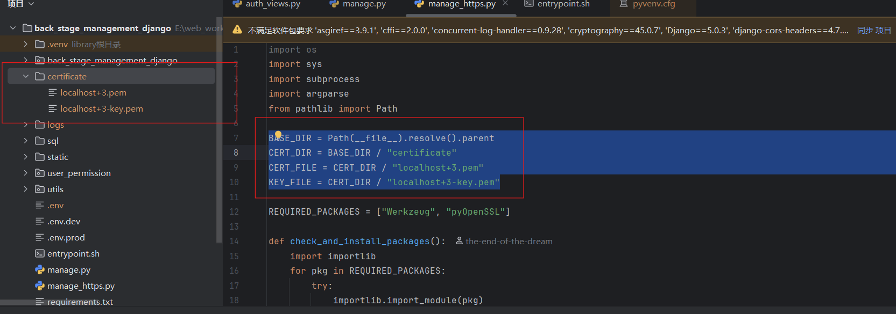

#### 为什么后端也要 HTTPS？因为：

- 前端通过 HTTPS 访问
- 后端如果是 HTTP，会触发 **混合内容（Mixed Content）** 错误
- Cookie 的 Secure 属性要求 **前后端都必须是 HTTPS**

#### 修改环境配置

修改.env

```
# 是否开启 Django DEBUG 模式
# True：开发环境（显示错误堆栈）
# False：生产环境（隐藏错误信息）
DEBUG=True

# ===========================
# ALLOWED_HOSTS 配置
# ===========================
# 允许访问 Django 的域名/IP 列表
# 写法 1：允许所有（开发环境常用）
# ALLOWED_HOSTS=*
#
# 写法 2：指定多个域名/IP，用逗号分隔
# ALLOWED_HOSTS=127.0.0.1,localhost,192.168.10.143
#
# 下面是示例（你可以按需修改）
ALLOWED_HOSTS=*

# ===========================
# CORS 跨域配置
# ===========================

# 写法 1：允许所有跨域（开发环境常用）
# CORS_ORIGINS=*

# 写法 2：指定允许跨域的域名（生产环境推荐）
# CORS_ORIGINS=http://localhost:8080,http://192.168.10.143:8080

# 你当前开发环境建议使用：
CORS_ORIGINS=*

# ===========================
# MySQL 数据库配置
# ===========================
MYSQL_HOST=localhost
MYSQL_PORT=3306
MYSQL_USER=root
MYSQL_PASSWORD=111111
MYSQL_DB=backstage

# ===========================
# Redis 配置
# ===========================
REDIS_HOST=127.0.0.1
REDIS_PORT=6379
REDIS_DB=0

# ===========================
# JWT 密钥（务必保密）
# ===========================
JWT_SECRET_KEY=aaaaaaaaaaaaaaaaaaaaaaaaaaaaaaaaaaaaaaaaaa

```

#### 开发环境启动方式

注意：

1. **启动前先安装好mysql，redis**
2. **修改后端项目下的.env文件配置信息**

启动命令

```
python manage_https.py --host 127.0.0.1 --port 8000
```

##### 开发环境局域网启动访问示例：

```
python manage_https.py --host 192.168.10.143 --port 8000
```

访问地址：

```
https://192.168.10.143:8000
```

### 5.开发环境证书生成参考

证书生成可参考：

https://blog.csdn.net/dreams_dream/article/details/151352681?spm=1001.2014.3001.5501

## 生产环境

### docker本地部署示例

#### 修改环境变量

后端修改.env.prod

前端修改.env.production

#### 进入docker_deploy目录，命令行执行

##### windows

```
deploy.bat
```

##### linux

```
deploy.sh
```

# 项目展示

## 登录界面

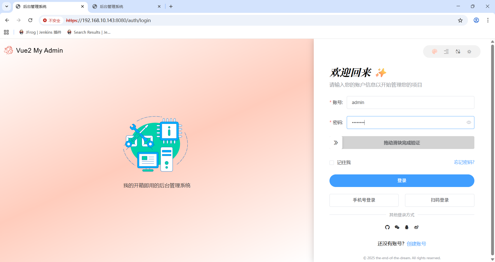

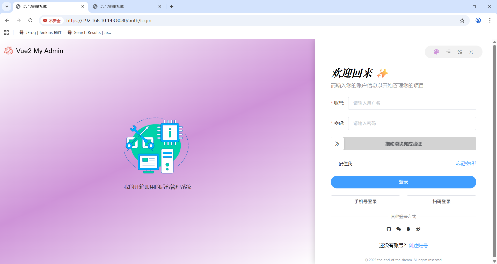

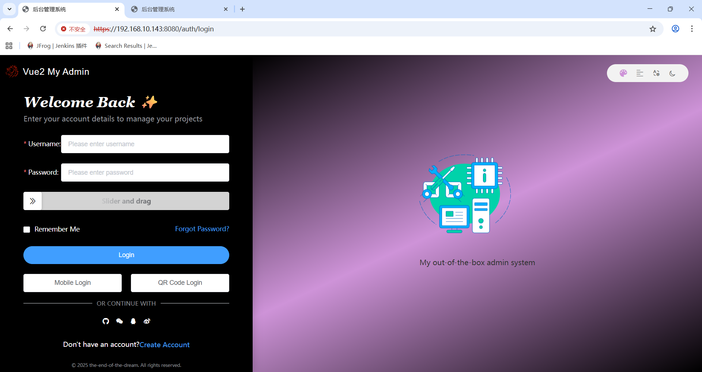

## 功能页

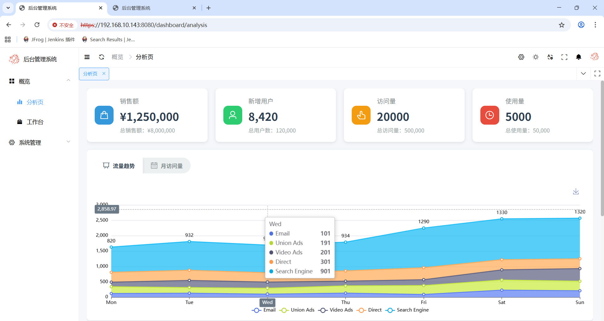

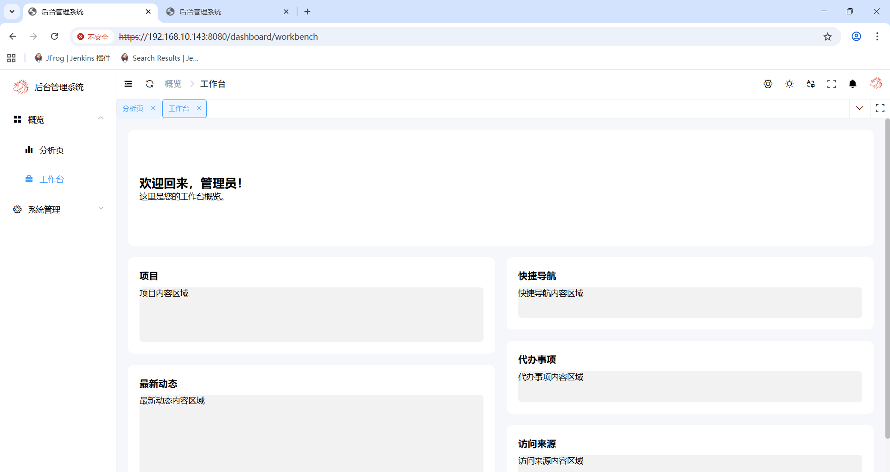

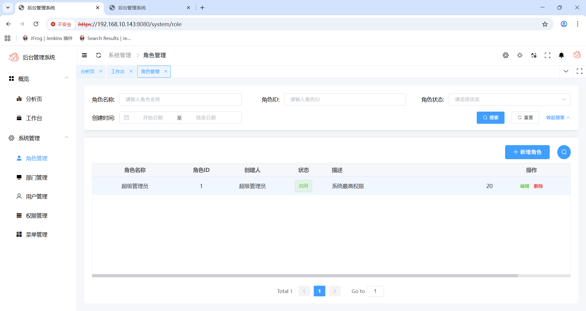


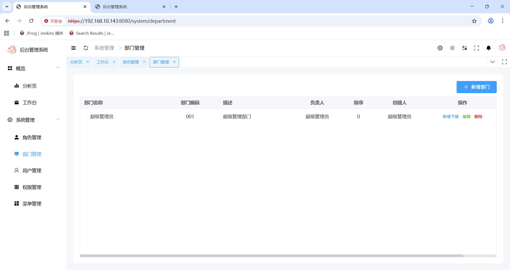

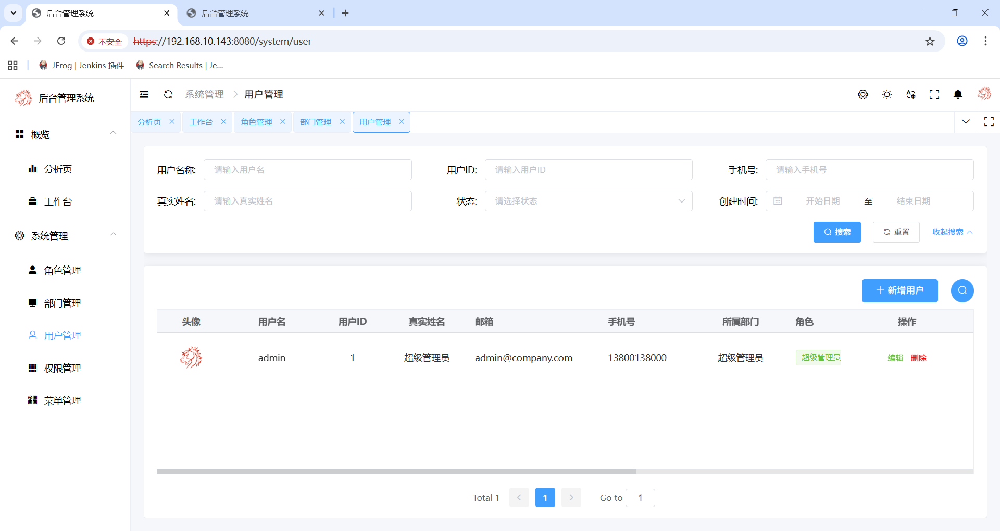

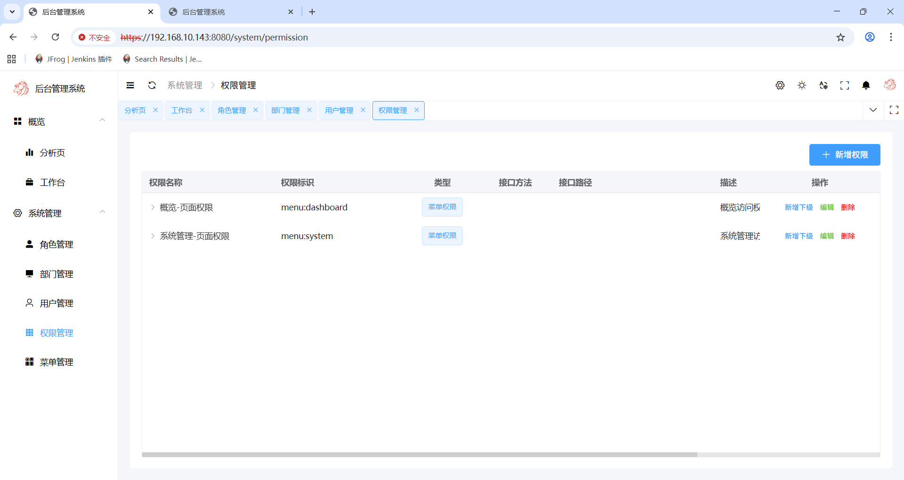

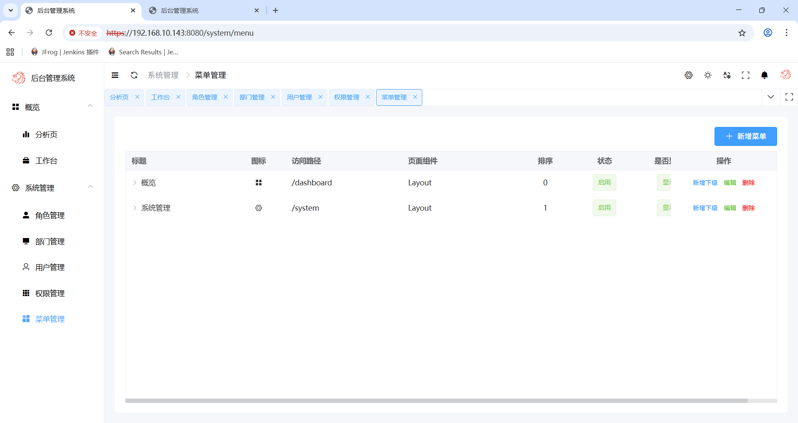

## 锁屏

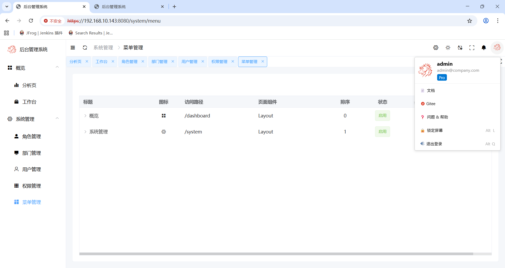

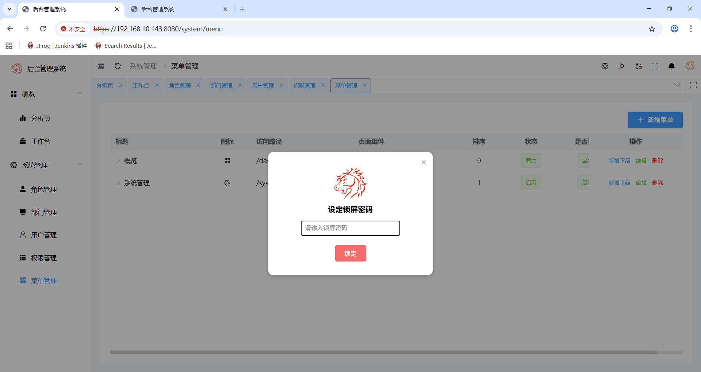

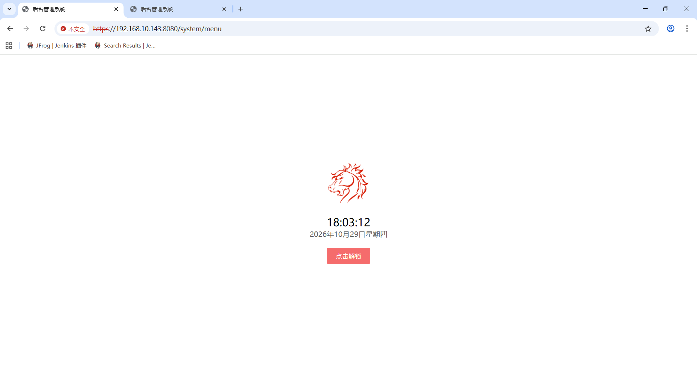
